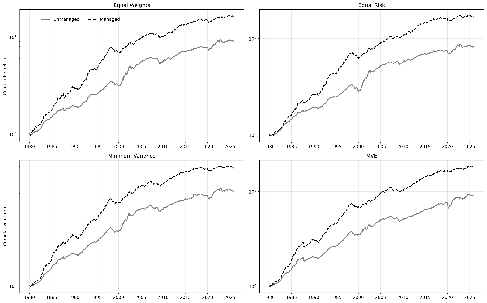

# Volatility Management in Multifactor Equity Portfolios

[](https://github.com/platonvasyliev/volatility-managed-multifactor-portfolios/actions/workflows/tests.yml)

**Performance, Costs, and Sentiment** · MSc Finance (Quantitative Finance) thesis, University of Amsterdam, 2026 · Platon Vasyliev

This repository contains the code and data needed to reproduce every table and figure in the thesis.

## Research question

> How does volatility management affect the performance of multifactor equity portfolios constructed using different allocation methods?

Volatility management (Moreira and Muir, 2017) scales a portfolio's exposure down after volatile months and up after calm ones. I apply it to seven U.S. equity factors (Market, Size, Value, Profitability, Investment, Momentum, Betting-Against-Beta) and to four multifactor portfolios (equal weights, equal risk, minimum variance and mean-variance efficient), from February 1980 to December 2025. Portfolio weights are formed strictly out-of-sample.

* **H1:** Volatility management improves the gross performance of multifactor portfolios.
* **H2:** After transaction costs, these gains disappear.

## Key findings

| | Equal Weights | Equal Risk | Minimum Variance | MVE |
|---|---|---|---|---|
| Sharpe ratio, unmanaged | 1.09 | 1.10 | 1.16 | 1.14 |
| Sharpe ratio, volatility-managed | **1.37** | **1.47** | **1.45** | **1.50** |
| Bootstrap p-value | 0.001 | <0.001 | <0.001 | <0.001 |
| Sharpe ratio net of costs, unmanaged | 0.69 | 0.66 | 0.50 | 0.50 |
| Sharpe ratio net of costs, volatility-managed | 0.38 | 0.35 | 0.27 | 0.31 |

*Full sample 1980-2025. From Tables 2 and 3.*

1. **Single factors:** volatility management significantly raises gross Sharpe ratios for Momentum (0.38 → 0.83), BAB (0.81 → 1.21) and Profitability (0.51 → 0.73), but not for Market, Size, Value or Investment.
2. **Multifactor portfolios:** gross Sharpe ratios improve significantly for all four construction methods, in both 1980-2002 and 2003-2025 (supports H1).
3. **Transaction costs:** after costs, the managed multifactor portfolios underperform their unmanaged counterparts (supports a stronger version of H2).
4. **Sentiment:** confirming Barroso and Detzel (2021), volatility management helps the Market factor only in high-sentiment years. The pattern does not carry over to the other factors or to factor ETFs.



## Methodology in brief

* **Volatility management (Eq. 1):** `f_vm[t+1] = c / σ[t] · f[t+1]`, where σ[t] is the realized volatility of daily returns in month t. The constant c matches the unmanaged volatility and does not affect Sharpe ratios.
* **Portfolio construction:** equal weights; equal risk (inverse 252-day volatility); minimum variance and maximum Sharpe ratio, both with a 126-day Ledoit-Wolf covariance matrix, 120-month mean returns, and weights between 5% and 50%. Rebalanced monthly.
* **Inference:** stationary block-bootstrap test of the Sharpe-ratio difference (10,000 samples, average block of 5 months), spanning-regression alphas with Newey-West standard errors, and the Jobson-Korkie-Memmel test as a robustness check.
* **Transaction costs:** factor-level turnover and cost estimates from Barroso and Detzel (2021), charging both the cost of holding each factor and the cost of changing exposure.
* **Sentiment:** each year is classified as high or low sentiment by the prior December value of the orthogonalized Baker-Wurgler index, relative to its 1980-2023 median.

## Reproducing the results

Requires Python 3.10 or newer.

```bash
git clone https://github.com/platonvasyliev/volatility-managed-multifactor-portfolios.git
cd volatility-managed-multifactor-portfolios
python -m venv .venv
source .venv/bin/activate        # on Windows: .venv\Scripts\activate
pip install -e .
python analysis/run_all.py
```

This rewrites everything in `results/` in about 3 minutes, using only the data in `data/` (no internet connection needed). Each script can also be run on its own, e.g. `python analysis/03_multifactor.py`.

Run the tests with `pip install -e ".[dev]"` and `pytest`.

## Where each result comes from

| Thesis | Script | Output in `results/` |
|---|---|---|
| Figure 1, Tables A1-A2 | `analysis/01_methodology.py` | `figure_1_*`, `table_A1_*`, `table_A2_*` |
| Figure 2, Table 1 (A3), Figure 3, Table A7 | `analysis/02_single_factors.py` | `figure_2_*`, `table_1_*`, `table_A3_*`, `figure_3_*`, `table_A7_*` |
| Table A4, Figures 4-5, Tables 2 (A5), 3, A8 | `analysis/03_multifactor.py` | `table_A4_*`, `figure_4_*`, `figure_5a_*`, `figure_5b_*`, `table_2_*`, `table_A5_*`, `table_3_*`, `table_A8_*` |
| Figure 6, Tables 4-5 | `analysis/04_sentiment.py` | `figure_6_*`, `table_4_*`, `table_5_*` |
| Table 6 | `analysis/05_etfs.py` | `table_6_*` |
| Figures A1-A2, Table A6 | `analysis/06_covariance_robustness.py` | `figure_A1_*`, `figure_A2_*`, `table_A6_*` |

Tables are saved as CSV and as Markdown.

### Differences from the PDF

The code reproduces the thesis, with a few small, deliberate corrections. None of them changes a conclusion:

* **One sample for everything.** All statistics use February 1980 to December 2025 (551 months); January 1980 only provides the first volatility estimate. The thesis mixed this window with one starting in January 1980 for some unmanaged statistics, so a few of those differ by about 0.01 (e.g. Market Sharpe ratio 0.56 instead of 0.57). Managed Sharpe ratios, Sharpe-ratio differences, p-values and t-statistics are unaffected.
* **Ledoit-Wolf throughout.** Figures 4 and 5b and the full-sample alphas of the Minimum Variance and MVE portfolios in Table 2 now use the Ledoit-Wolf portfolios, like the rest of the analysis. The PDF used the sample-covariance versions there by mistake (Minimum Variance alpha 1.37%, t = 4.93, instead of 1.39%, t = 5.16).
* **Table A6** measures turnover from the second month, as the first month only sets up the initial position (55.33% instead of 55.23% for Minimum Variance).
* **Table 6:** the high-sentiment numbers for the Momentum ETF (MTUM) in the PDF cannot be reproduced from the price data; the repository gives a Sharpe ratio of -0.00 unmanaged and 0.06 managed (PDF: 0.31 and 0.35). The difference remains small and insignificant, as stated in the thesis.

## Repository structure

```
├── analysis/            one script per thesis section + run_all.py
├── data/                factor and sentiment data (see data/README.md)
├── results/
│   ├── figures/
│   └── tables/
├── src/vmp/             the methodology as a small Python package
│   ├── config.py                  sample period and all parameters
│   ├── data.py                    loading the data
│   ├── factor_portfolios.py       equal weights, equal risk, minimum variance, MVE
│   ├── volatility_management.py   realized volatility and Eq. 1
│   ├── transaction_costs.py       Barroso-Detzel cost model
│   ├── inference.py               Sharpe ratios, bootstrap, JKM, spanning regressions
│   ├── sentiment.py               sentiment regimes
│   ├── pipeline.py                builds all return series used in the analysis
│   ├── plotting.py, reporting.py
└── tests/
```

## Data

The data come from the Kenneth R. French Data Library (Fama-French factors and Momentum), AQR (Betting-Against-Beta) and Jeffrey Wurgler (investor sentiment). A snapshot is included so that results can be reproduced exactly; see [data/README.md](data/README.md) for sources and the small cleaning steps.

## Citation

```
Vasyliev, P. (2026). Volatility Management in Multifactor Equity Portfolios:
Performance, Costs, and Sentiment. MSc thesis, University of Amsterdam.
```

## License

Code: MIT. The data belong to their respective providers (see `data/README.md`).
